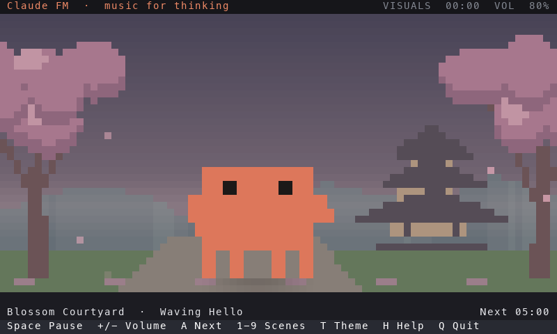
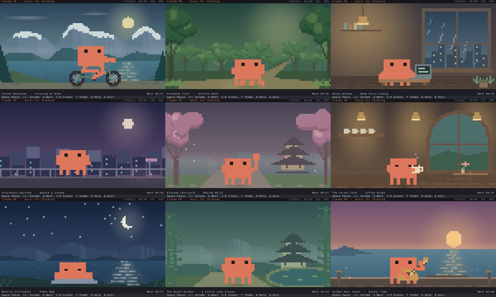

# Claude FM

**Lo-fi radio, a little Clawd, and nine quiet worlds inside your terminal.**

[](https://github.com/jurek-zsl/claudefm/actions/workflows/ci.yml)
[](pyproject.toml)
[](#requirements)
[](LICENSE)



A community-built player for [Claude FM](https://www.youtube.com/watch?v=tRsQsTMvPNg). Listen while Clawd cycles through bike rides, coffee breaks, sunset guitar sessions, and other small moments. The Python app uses only the standard library; `mpv` and `yt-dlp` handle audio.

- **Deliberate movement:** a 24 fps pixel rig, forest strolls and bike rides between visible destinations, sipping pauses, and occasional blinks.
- **Nine matching worlds:** atmospheric landscapes, warm room lighting, natural foliage, and water reflecting the sun and moon.
- **A comfortable pace:** soft contact shadows, settled props, gentle rain, drifting petals, and quiet fireflies in both palettes.
- **A calm rotation:** activity and background change together every five minutes.
- **Terminal-native controls:** pause, volume, mute, theme switching, and a silent visuals mode.

## Install

### macOS · Homebrew

```sh
brew tap jurek-zsl/claudefm https://github.com/jurek-zsl/claudefm
brew install jurek-zsl/claudefm/claudefm
claudefm
```

The community tap lives in this repository. Homebrew installs Python, `mpv`, and `yt-dlp` along with the app.

To get the latest version:

```sh
brew update
brew upgrade jurek-zsl/claudefm/claudefm
```

<details>
<summary>Install with pipx instead (macOS or Linux)</summary>

Install `mpv`, `yt-dlp`, and `pipx` with your package manager. On macOS, use `brew install mpv yt-dlp pipx`. Then install the CLI from this repository:

```sh
pipx install 'git+https://github.com/jurek-zsl/claudefm.git'
pipx ensurepath
claudefm
```

If `pipx` asks you to refresh your PATH, open a new terminal before running `claudefm`. This method pulls the source from GitHub.

</details>

<details>
<summary>Run from source in a virtual environment</summary>

```sh
git clone https://github.com/jurek-zsl/claudefm.git
cd claudefm
python3 -m venv .venv
source .venv/bin/activate
python -m pip install -e .
claudefm --no-audio
```

</details>

## Make yourself comfortable

```sh
claudefm                         # Start the radio
claudefm --no-audio               # Just Clawd and the scenery
claudefm --dark -a guitar -v 60   # Sunset guitar, dark palette, 60% volume
claudefm --light -a coffee        # A warm cafe in the light palette
claudefm --check-audio            # Verify real audio playback, then exit
```

Use `--activity` / `-a` to choose a scene and `--volume` / `-v` for the initial volume. A positional URL selects another stream. `claudefm --help` lists every option.

The theme follows the macOS system appearance **at startup**. Linux defaults to light. `--light` and `--dark` override the initial choice; `T` switches it during a session.

The five-minute countdown continues while audio is paused. Choosing an activity manually starts a fresh countdown. Pausing freezes character and ambient motion until the next scheduled scene change or resume.

| Key | Action |
|---|---|
| Space | Play / pause |
| + / k, - / j | Volume up / down |
| M | Mute / unmute |
| A / Tab | Next activity and background |
| 1–9 | Choose a scene from the table below |
| T | Switch light / dark |
| H / ? | Show / hide help |
| Q / Ctrl+C | Quit and restore the terminal |

## Nine little worlds



| Key | Activity option | World |
|---|---|---|
| 1 | `bike` | Alpine Daydream — mountains and a lakeside pass |
| 2 | `walk` | Fernwood Trail — a sunlit forest clearing |
| 3 | `coding` | Rainy Window — city lights and a quiet study |
| 4 | `bounce` | Afterhours Rooftop — lavender dusk and neon windows |
| 5 | `wave` | Blossom Courtyard — petals and a distant pagoda |
| 6 | `coffee` | The Corner Cafe — warm lamps and a garden window |
| 7 | `napping` | Moonlit Stillwater — a crescent moon over a lake |
| 8 | `idle` | The Quiet Garden — bamboo and misty mountains |
| 9 | `guitar` | Golden Hour Coast — sunset, a timber pier, and fireflies |

## Requirements and troubleshooting

Python **3.8+**, macOS or Linux, and a terminal with truecolor and Unicode half-block support. The minimum window is **64 columns × 18 rows**. Audio also needs `mpv`, `yt-dlp`, network access, and an available stream; `--no-audio` needs none of those audio dependencies.

If the radio is silent, run `claudefm --check-audio`. It checks decoded playback and an active output, then reports success or a useful error. The app distinguishes connecting, buffering, playing, paused, audio errors, and visuals-only mode.

- **Missing player or extractor:** install `mpv` and `yt-dlp`. Homebrew's unlinked `yt-dlp` installation is detected automatically.
- **Stream extraction fails:** update `yt-dlp`, check the stream URL and network access, then retry the audio check.
- **Clipped or unusual graphics:** enlarge the window, use a truecolor terminal, and try a monospace font with half-block characters.

## Develop and contribute

```sh
python -m unittest discover -s tests -v
./build_binary.sh              # Build locally into dist/claudefm
./build_binary.sh --install    # Also install the resulting executable locally
```

See [CONTRIBUTING.md](CONTRIBUTING.md) for setup, visual previews, packaging checks, and contribution guidance. Changes are tracked in [CHANGELOG.md](CHANGELOG.md). Bug reports and contributions are welcome through [GitHub issues](https://github.com/jurek-zsl/claudefm/issues) and pull requests.

## License and attribution

Original project code and contributions are [MIT licensed](LICENSE). Claude, Clawd, and their associated branding and character design belong to Anthropic. This community project is unaffiliated with Anthropic and does not bundle or redistribute the stream's music. See [NOTICE](NOTICE) for attribution and the scope of third-party rights.
